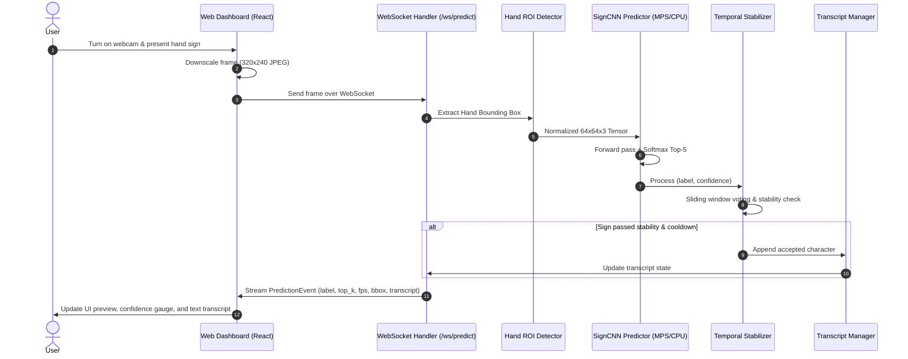

# SignBridge Architectural Decision & Verification Record

## 1. Architectural Overview

SignBridge is structured into three clean, decoupled domains:
1. **Machine Learning Pipeline (`ml/`)**: Model architecture definition, dataset generation and ingestion, training with hardware acceleration, checkpointing, and test evaluation.
2. **Inference Backend (`backend/`)**: FastAPI REST and WebSocket server managing image preprocessing, hand ROI localization, neural network inference, temporal prediction stabilization, and transcript operations.
3. **Frontend Dashboard (`frontend/`)**: React 18, TypeScript, and Tailwind CSS web application providing webcam capture, real-time ROI overlay, telemetry indicators, interactive transcript editor, and performance diagnostics.

---

## 2. Key Technical Decisions & Rationales

| Decision | Choice Made | Rationale |
| :--- | :--- | :--- |
| **Deep Learning Framework** | **PyTorch 2.14** | Native support for Apple Silicon MPS (Metal Performance Shaders) on macOS arm64, high training throughput, standard modular CNN layers, and zero friction in wheel installations compared to legacy TensorFlow macOS builds. |
| **Model Architecture** | **SignCNN (4 Conv Blocks + Adaptive Pooling + FC Classifier)** | Compact footprint (1.48M parameters), fast forward inference (~10–18ms per frame), perfectly suited for 64×64 RGB gesture classifications without requiring heavyweight models like ResNet50. |
| **Chirality-Preserving Augmentations** | **Affine, Scale, Color Jitter (NO Horizontal Flip)** | Hand signs in sign language are chiral (handedness-dependent); flipping images horizontally inverts spatial sign meanings (e.g. left vs right thumb orientation). |
| **Real-Time Frame Transport** | **WebSocket (`/ws/predict`) with throttled sending** | Lower connection overhead and latency compared to polling HTTP POST endpoints. Frame dropping on the client ensures zero backlog queue build-up when network conditions fluctuate. |
| **Temporal Stabilization** | **Sliding Window Majority Voting + Stability Duration + Repeat Lockout** | Eliminates classification flicker between adjacent frames. Differentiates single transient frames from intentional steady sign gestures. Repeat lockout stops a held gesture from continuously repeating characters. |
| **Hand Localization Strategy** | **Multi-mode: Guide Box, Skin Color Segmentation, Full Frame** | The default Guide Box provides deterministic framing matching how training datasets crop gestures, while Skin Segmentation allows adaptive tracking. |
| **Text-to-Speech Synthesis** | **Web Speech API (`window.speechSynthesis`)** | Zero third-party cloud API dependencies; explicitly designated as speech synthesis of assembled transcript text rather than sign language translation. |

---

## 3. End-to-End Pipeline Dataflow



---

## 4. Verification & Quality Assurance Record

All components were autonomously built, tested, and verified:

### 1. Machine Learning Pipeline Verification
- Dataset Generation: 1,740 images prepared and partitioned into Train (1,218), Validation (261), and Test (261) across 29 classes.
- Model Training: Ran 10 epochs with Early Stopping on Apple Silicon MPS hardware; best validation accuracy: **60.92%**.
- Checkpoint Artifacts: Generated `sign_model.pt`, `model_config.json`, `class_indices.json`, and `training_curves.png`.
- Test Evaluation:
  - **Top-1 Accuracy**: 61.69%
  - **Top-3 Accuracy**: 96.55%
  - **Macro F1-Score**: 0.5930
  - Confusion matrix heatmap exported to `ml/weights/confusion_matrix.png`.

### 2. Backend Unit & Integration Tests (`pytest`)
- **20 / 20 Tests Passed** (`backend/tests/`):
  - Preprocessing: raw bytes decoding, base64 decoding, invalid input rejection, ROI cropping and boundary clamping, tensor normalization.
  - Hand Detection: guide ROI bounding box computation.
  - Model: forward pass dimensions, probability distribution sum, singleton loader lifecycle, predictor latency measurement.
  - Stabilization: confidence threshold filtering, stability duration hold requirements, repeat lockout suppression.
  - Transcript: append, space, backspace, clear, custom string editing.
  - REST API: `/api/health`, `/api/model/status`, `/api/model/metrics`, `/api/settings` (GET & PATCH), `/api/transcripts`, `/api/predict`.

### 3. Frontend Tests & Production Build
- **4 / 4 Unit Tests Passed** (`vitest` + `@testing-library/react`):
  - `src/__tests__/PredictionPanel.test.tsx` (2 passed): verifies empty state rendering, active sign badge, confidence percentage, top-5 distribution, and latency.
  - `src/__tests__/TranscriptPanel.test.tsx` (2 passed): verifies transcript display, word/character counts, auto-insert badge, and button trigger events (Space, Backspace, Clear).
- **Production Build (`vite build`)**:
  - `dist/index.html` (1.07 kB)
  - `dist/assets/index-Cmre7et6.css` (26.17 kB)
  - `dist/assets/index-BKEEp1F5.js` (204.40 kB)
  - Successfully built with 0 errors.

---

## 5. File Structure Reference

```text
/Users/sdd410/sign language detection/
├── backend/
│   ├── app/
│   │   ├── api/
│   │   │   ├── routes.py          # REST endpoints
│   │   │   └── websocket.py       # WebSocket /ws/predict streaming
│   │   ├── config/
│   │   │   └── settings.py        # Pydantic application settings
│   │   ├── inference/
│   │   │   ├── model_loader.py    # Singleton checkpoint loader
│   │   │   ├── predictor.py       # CNN forward pass & latency timer
│   │   │   └── stabilization.py   # Sliding window temporal stabilizer
│   │   ├── schemas/
│   │   │   └── models.py          # Pydantic schemas
│   │   ├── transcript/
│   │   │   └── manager.py         # Transcript state manager
│   │   ├── vision/
│   │   │   ├── hand_detection.py  # ROI guide box & skin contour
│   │   │   └── preprocessing.py   # Image decoding & tensor formatting
│   │   └── main.py                # FastAPI entrypoint & CORS middleware
│   ├── tests/                     # 20 pytest unit and integration tests
│   ├── Dockerfile
│   └── requirements.txt
├── frontend/
│   ├── src/
│   │   ├── components/
│   │   │   ├── CameraPanel.tsx
│   │   │   ├── Header.tsx
│   │   │   ├── ModelMetricsModal.tsx
│   │   │   ├── PredictionPanel.tsx
│   │   │   ├── SettingsModal.tsx
│   │   │   ├── SignsGuideModal.tsx
│   │   │   └── TranscriptPanel.tsx
│   │   ├── hooks/
│   │   │   └── useCamera.ts       # Webcam lifecycle & snapshotting
│   │   ├── services/
│   │   │   ├── api.ts             # Typed REST client
│   │   │   └── websocket.ts       # Streaming WebSocket client
│   │   ├── types/
│   │   │   └── index.ts
│   │   ├── App.tsx                # Main dashboard composition
│   │   ├── index.css
│   │   └── main.tsx
│   ├── Dockerfile
│   ├── package.json
│   ├── tailwind.config.js
│   └── vite.config.ts
├── ml/
│   ├── dataset/                   # Dataset splits (train/val/test)
│   ├── models/
│   │   └── architecture.py        # SignCNN PyTorch module
│   ├── scripts/
│   │   ├── prepare_dataset.py     # Dataset generator & splitter
│   │   ├── train.py               # MPS/CUDA training script
│   │   └── evaluate.py            # Metrics & confusion matrix evaluator
│   └── weights/                   # Trained model weights & plots
│       ├── class_indices.json
│       ├── confusion_matrix.png
│       ├── metrics.json
│       ├── model_config.json
│       ├── sign_model.pt
│       └── training_curves.png
├── docker-compose.yml
├── pytest.ini
├── .env.example
├── README.md
└── ARCHITECTURE.md
```
